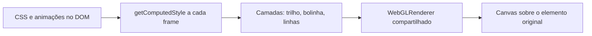

<div align="center">


# Checkbox3D

**O checkbox que você já escreveu em CSS, desenhado por three.js.**

Lê tamanho, cor, cantos, transformações e animações direto do DOM e reproduz tudo numa cena WebGL.
Nenhum keyframe reescrito.

[](LICENSE)
[](https://discourse.threejs.org/u/joaotysm/)
[](#início-rápido)
[](#início-rápido)

[Início rápido](#início-rápido) · [Showcase](#showcase) · [Como funciona](#como-funciona) · [API](#api) · [Limitações](#limitações)

</div>

---

## Por que existe

Animar um toggle em CSS é simples. Levar o mesmo toggle para dentro do three.js costuma significar refazer tudo: geometrias, cores, easing, keyframes, estados.

O Checkbox3D faz o caminho inverso. O navegador continua sendo a fonte da verdade e o three.js só desenha o resultado. Você mantém o HTML, o CSS e o JavaScript que já tem e ganha um render em WebGL por cima.

## Início rápido

**1. Seu markup, como já está**

```html
<div class="checkbox">
  <div class="knob">
    <div class="line1"></div>
    <div class="line2"></div>
  </div>
</div>
```

**2. Uma linha no final da página**

```html
<script type="module" src="https://cdn.jsdelivr.net/gh/joaoTYSM/three.js@main/discord/checkbox/import.js"></script>
```

Todo elemento `.checkbox` da página passa a ser renderizado pelo three.js. O clique, as classes `checked` e `unchecked` e o seu script continuam funcionando sem alteração. O three.js é carregado pelo próprio arquivo, sem import map e sem build.

Para deixar um elemento específico em CSS puro, adicione o atributo `data-css`:

```html
<div class="checkbox" data-css>...</div>
```

### Montagem manual

Com `?manual` na URL, nada é montado automaticamente e você controla quando e quais elementos entram:

```html
<script type="module">
  import { mount } from 'https://cdn.jsdelivr.net/gh/joaoTYSM/three.js@main/discord/checkbox/import.js?manual';

  const checkboxes = mount('.meu-toggle');
</script>
```

## Showcase

O arquivo [`showcase.html`](showcase.html) reúne uma comparação lado a lado entre CSS puro e three.js, tamanhos de 1x a 5x, cores por variável CSS e um painel de configurações. Abra por um servidor local:

```bash
npx serve
```

## Como funciona



1. O elemento original continua na página: recebe cliques, aplica classes e executa as transições e animações do CSS.
2. A cada frame, o Checkbox3D percorre a árvore de filhos e lê o valor calculado de cada elemento.
3. Cada elemento vira uma camada no three.js, desenhada por um shader que gera retângulos arredondados com borda suavizada, em qualquer tamanho e rotação.
4. Um único `WebGLRenderer` atende todos os checkboxes, o que evita o limite de contextos WebGL do navegador. O resultado é copiado para um canvas posicionado sobre o elemento.
5. O elemento original só é ocultado depois do primeiro frame desenhado com sucesso. Se o WebGL falhar, o CSS continua visível.
6. Se nada mudou desde o último frame, nada é desenhado.

Como o valor lido é o que o navegador está calculando naquele instante, tudo o que o CSS faz aparece igual no render: `@keyframes` com várias etapas, `animation-direction: reverse`, `transition` de cor, variáveis CSS e interrupções no meio do clique.

### O que é lido

| Propriedade | Uso |
| --- | --- |
| `width`, `height`, `box-sizing` | Tamanho de cada camada |
| `background-color`, `opacity` | Cor e transparência, com opacidade acumulada dos pais |
| `border-*-radius` | Cantos em `px` ou `%`, com a mesma redução proporcional do CSS |
| `left`, `top` | Posição relativa ao pai |
| `transform`, `transform-origin` | Rotação, escala e translação dos filhos, incluindo `matrix3d` |
| `display: none` | Oculta a camada e todos os filhos |

A escala aplicada ao próprio `.checkbox` (por `transform: scale()` ou `zoom`) não é lida como camada. Ela é usada para aumentar a resolução do canvas, então o desenho continua nítido.

## API

```js
const checkboxes = mount(selector, options);
```

| Parâmetro | Padrão | Descrição |
| --- | --- | --- |
| `selector` | `'.checkbox'` | Seletor CSS dos elementos que serão renderizados |
| `options.observe` | `true` | Monitora o DOM e passa a renderizar checkboxes adicionados depois |
| `options.pixelRatio` | `devicePixelRatio` | Resolução do canvas |

O retorno é um objeto com:

- `instances`: `Map` de elemento para instância ativa
- `destroy()`: restaura os elementos originais e libera os recursos da GPU

## Limitações

- Só `background-color` é desenhado. Bordas, `box-shadow`, gradientes, imagens e texto não são.
- Raios em porcentagem são tratados como circulares. Em elementos não quadrados, o CSS desenharia uma elipse.
- Os filhos são lidos na montagem. Elementos adicionados depois dentro de um checkbox já montado não são acompanhados.
- O elemento original recebe `visibility: hidden` enquanto o render está ativo. Se a acessibilidade importa no seu caso, adicione um `<input type="checkbox">` real com os atributos ARIA adequados.
- Requer WebGL2.

## Estrutura

```
discord/checkbox/
├── assets/
│   └── preview.svg
├── import.js
├── showcase.html
├── LICENSE
└── README.md
```

## Contribuindo

Issues e pull requests são bem-vindos. Para mudanças maiores, abra primeiro uma issue descrevendo o que você pretende alterar.

## Licença

[MIT](LICENSE)
